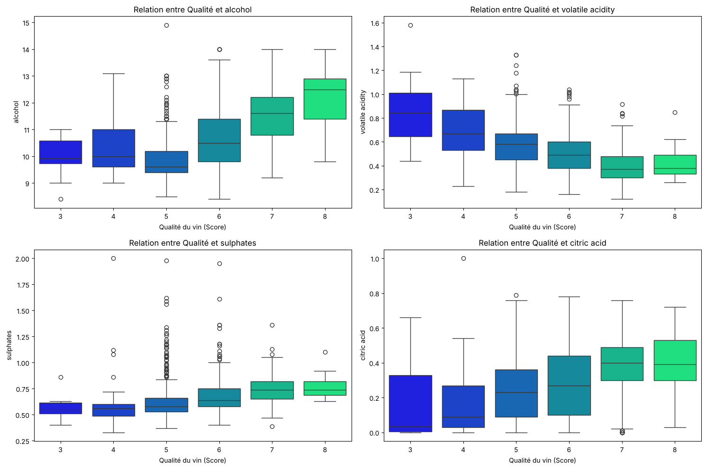
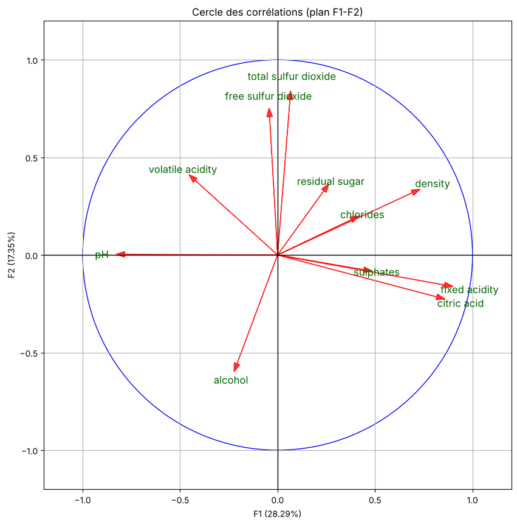
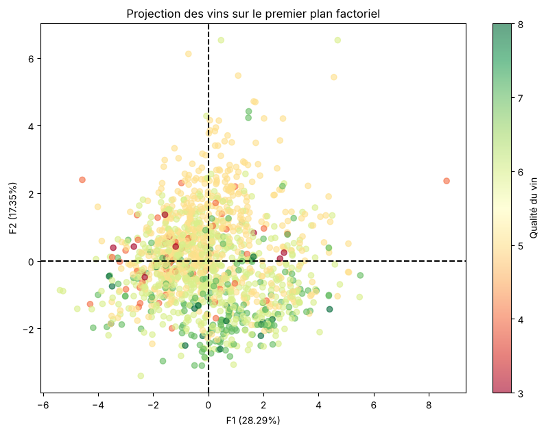

# Analyse exploratoire de la qualité des vins rouges

Analyse statistique du jeu de données **Wine Quality** (vins rouges portugais « Vinho Verde ») avec Python.
L'objectif est de comprendre quelles caractéristiques physico-chimiques sont liées à la note de qualité d'un vin.

**Outils :** Python, pandas, NumPy, Matplotlib, Seaborn, SciPy, scikit-learn, Jupyter

## Les données

- **Source :** [UCI Machine Learning Repository – Wine Quality](https://archive.ics.uci.edu/dataset/186/wine+quality) (Cortez et al., 2009)
- **1 599 vins rouges** décrits par **11 variables physico-chimiques** (acidité, sucre, sulfates, alcool, pH…)
- **Variable cible :** `quality`, une note de 0 à 10 attribuée par des experts (de 3 à 8 dans les données)

## Démarche

| Étape | Notebook | Contenu |
|---|---|---|
| 1 | [`01_donnees_de_travail`](notebooks/01_donnees_de_travail.ipynb) | Aperçu du jeu de données, dimensions, variables |
| 2 | [`02_nettoyage_des_donnees`](notebooks/02_nettoyage_des_donnees.ipynb) | Types, valeurs manquantes, doublons, valeurs extrêmes |
| 3 | [`03_analyse_univariee`](notebooks/03_analyse_univariee.ipynb) | Tendance centrale, dispersion, asymétrie, courbes de Lorenz et indice de Gini |
| 4 | [`04_analyse_bivariee`](notebooks/04_analyse_bivariee.ipynb) | Corrélation, régression linéaire, tableau de contingence, boîtes à moustaches |
| 5 | [`05_acp`](notebooks/05_acp.ipynb) | Analyse en composantes principales (éboulis, cercle des corrélations, projection des vins) |

## Principaux résultats

**Nettoyage.** Aucune valeur manquante, mais 240 doublons supprimés. L'analyse porte sur **1 359 vins**.

**Les vins les mieux notés ont plus d'alcool, plus de sulfates et moins d'acidité volatile.**
L'alcool est la variable la plus liée à la qualité (corrélation de 0,48). Parmi les vins notés 7 ou 8,
87 % ont un degré d'alcool supérieur à la médiane, contre 23 % pour les vins notés 5.



**Acidité fixe et densité sont fortement liées** (r = 0,67, R² = 0,45) : plus un vin est acide, plus il est dense.

**ACP.** Les deux premiers axes résument 45,6 % de l'information.
L'axe F1 oppose les vins acides et denses aux vins à pH élevé ; l'axe F2 est porté par le dioxyde de soufre, à l'opposé de l'alcool.





## Structure du projet

```
wine-quality-analysis/
├── data/
│   ├── raw/winequality-red.csv            # données d'origine
│   └── processed/winequality_cleaned.csv  # données après nettoyage
├── images/                                # graphiques utilisés dans ce README
├── notebooks/                             # les 5 étapes de l'analyse
├── requirements.txt
└── README.md
```

## Lancer le projet

```bash
git clone https://github.com/<votre-compte>/wine-quality-analysis.git
cd wine-quality-analysis
pip install -r requirements.txt
jupyter notebook
```

Ouvrir ensuite les notebooks dans l'ordre, de `01` à `05`.

## Source des données

P. Cortez, A. Cerdeira, F. Almeida, T. Matos et J. Reis. *Modeling wine preferences by data mining from physicochemical properties.* Decision Support Systems, 47(4):547-553, 2009.
Jeu de données publié sous licence CC BY 4.0.

## Auteure

**Salma Mourad** – étudiante en M2 Ingénierie des systèmes complexes
